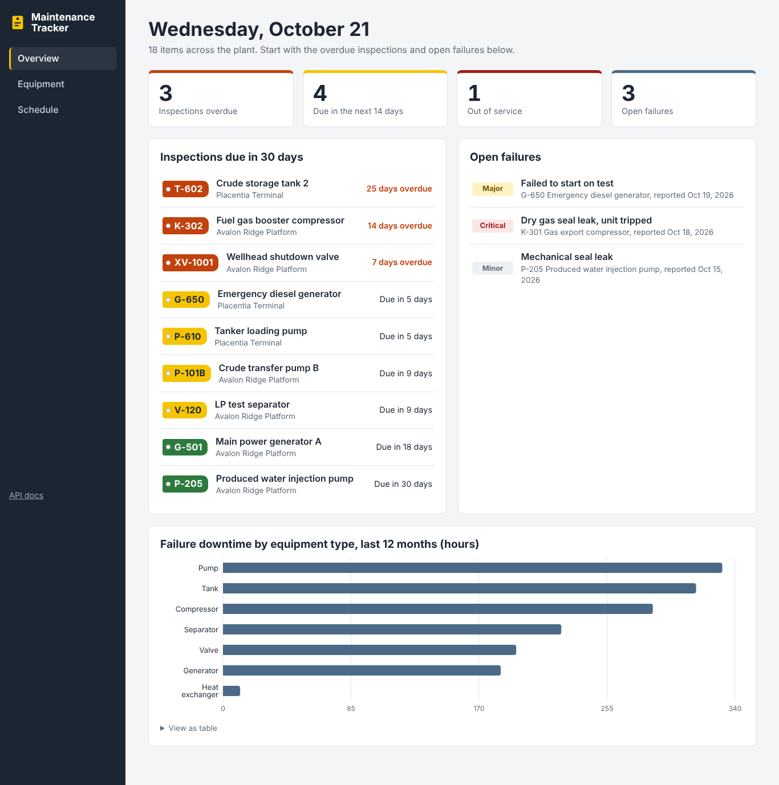
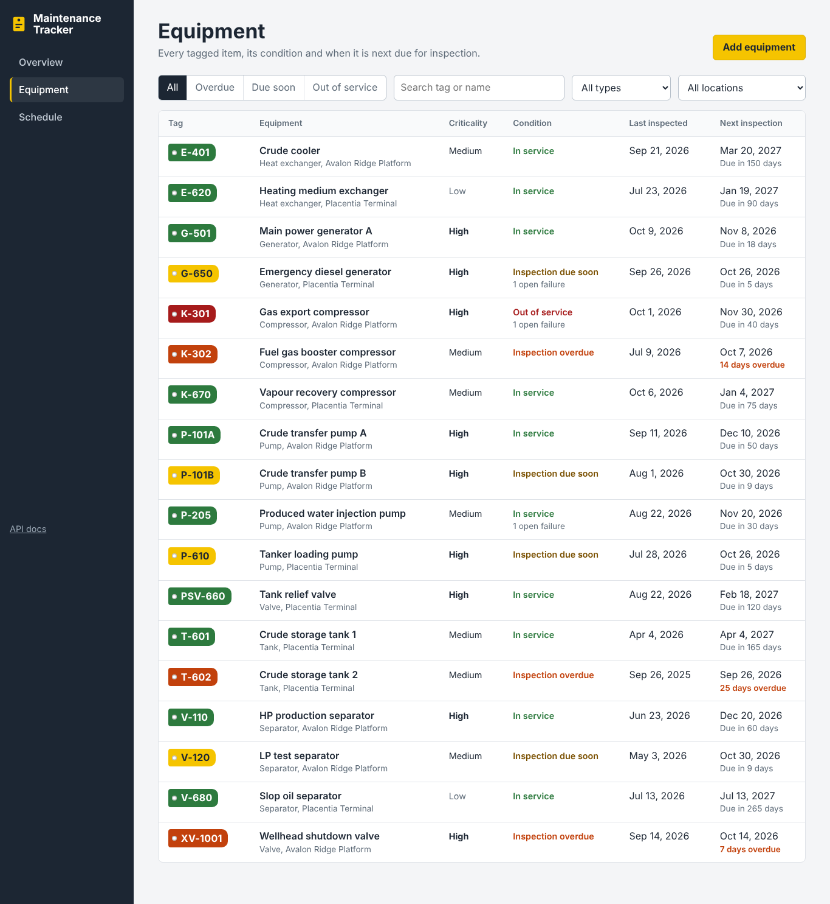
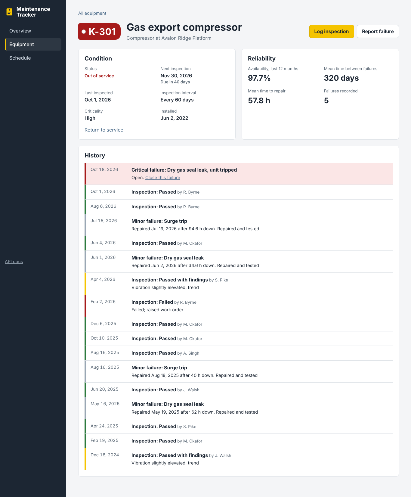

# Equipment Maintenance Tracker

[](https://github.com/Smartemmy1/equipment-maintenance-tracker/actions/workflows/ci.yml)

A full-stack web app for keeping plant equipment inspected and running. It schedules inspections from each item's interval, flags what is overdue, records failures and repairs, and calculates reliability metrics (availability, MTBF, MTTR) per item.

**Stack:** Python, FastAPI, SQLAlchemy 2.0, PostgreSQL / SQLite, React 19, TypeScript, React Router, Recharts, Docker, GitHub Actions



## Features

- **Overview:** counts of overdue inspections, inspections due in the next 14 days, out-of-service items and open failures, each linking to a filtered list; inspections due in 30 days; open failures; failure downtime by equipment type for the last 12 months.
- **Inspection scheduling:** each item has an inspection interval. The next due date is the last inspection plus the interval (or installation plus the interval if never inspected), and every item is classed as *overdue*, *due soon* or *ok*.
- **Equipment register:** search by tag or name, filter by type, location or condition. Filters live in the URL, so a filtered view can be bookmarked.
- **Equipment page:** condition, schedule, reliability metrics and a combined history of inspections and failures.
- **Inspections:** pass, pass with findings or fail. A failed inspection takes the item out of service.
- **Failures:** minor, major or critical. A critical failure takes the item out of service. Closing a failure records the repair and downtime and, once no other failures are open, returns the item to service.
- **Reliability metrics:**
  - *Availability* over the last 12 months, counting downtime of repaired failures and time open so far for unresolved ones
  - *MTBF* (mean time between failures)
  - *MTTR* (mean time to repair)
- **Schedule:** the inspection plan for the next 90 days grouped into overdue, this week, the next three weeks and later.
- **Demo data:** on first start the API seeds 18 items at two fictional facilities with two years of inspection and failure history.

The equipment tag number (P-101A, K-301) is shown as a coloured inspection tag, the way tags hang on equipment on site: green in service, yellow due soon, orange overdue, red out of service. The condition is always written out too, so it never relies on colour alone.





## Run it

### With Docker (recommended)

```bash
git clone https://github.com/Smartemmy1/equipment-maintenance-tracker.git
cd equipment-maintenance-tracker
docker compose up --build
```

- App: http://localhost:3000
- Interactive API docs: http://localhost:8000/docs

### Without Docker

Requires Python 3.13+ and Node.js 22+.

```bash
# Terminal 1: API (uses a local SQLite file)
cd backend
python -m venv .venv
source .venv/bin/activate        # Windows: .venv\Scripts\activate
pip install -r requirements-dev.txt
uvicorn app.main:app --reload

# Terminal 2: web app
cd frontend
npm install
npm run dev
```

Open http://localhost:5173. The dev server forwards `/api` calls to the API on port 8000.

To reset the demo data: `python -m app.seed` (from `backend/`).

## Tests and checks

```bash
cd backend
pytest              # 21 tests: scheduling, reliability maths and API behaviour
ruff check .        # lint
ruff format --check .

cd ../frontend
npm run build       # type-check and production build
```

GitHub Actions runs all of these, plus a Docker image build, on every push and pull request. Tests pin "today" to a fixed date through a FastAPI dependency, so date-based rules give the same result every day.

## API

| Method | Path | Purpose |
|---|---|---|
| GET | `/api/dashboard` | Counts, upcoming inspections, open failures, downtime by type |
| GET | `/api/equipment?q=&category=&location=&equipment_status=&inspection=` | Equipment with its schedule |
| GET | `/api/equipment/locations` | Location names |
| POST | `/api/equipment` | Add equipment |
| GET / PATCH / DELETE | `/api/equipment/{id}` | Read (with reliability metrics), update or delete |
| GET / POST | `/api/equipment/{id}/inspections` | Inspection history / log an inspection |
| GET / POST | `/api/equipment/{id}/failures` | Failure history / report a failure |
| POST | `/api/failures/{id}/resolve` | Close a failure with repair details and downtime |

Full request and response schemas are at `/docs` when the API is running.

## Project structure

```
backend/
  app/
    main.py                  FastAPI app, startup, CORS
    config.py                Settings (environment variables)
    database.py              Engine, per-request session, "today" dependency
    models.py                Equipment, Inspection, Failure tables
    schemas.py               Request/response validation (Pydantic)
    routers/                 equipment (+ inspections, failures), failures (resolve), dashboard
    services/maintenance.py  Due dates, inspection state, availability, MTBF, MTTR
    seed.py                  Demo data
  tests/                     pytest suite (in-memory SQLite, fixed date)
frontend/
  src/
    pages/                   Overview, EquipmentList, EquipmentDetail, Schedule
    components/              TagChip, Dialog, Forms, DowntimeChart
    api.ts                   Typed API client
docker-compose.yml           PostgreSQL + API + web app
.github/workflows/ci.yml     Lint, test, build
```

## Business rules

| Event | Effect |
|---|---|
| Inspection logged | Next due date moves to inspection date + interval |
| Inspection failed | Equipment goes out of service |
| Critical failure reported | Equipment goes out of service |
| Failure closed with "return to service" | Back in service if no other failures are open |
| Dates in the future | Rejected for installation, inspections, failures and repairs |
| Repair date before report date | Rejected |
| Duplicate tag number | Rejected (409) |

## Possible next steps

- Work orders with assignees and parts, linked to failures
- User accounts and roles (technician, planner, supervisor)
- Email or Slack reminders before inspections fall due
- Alembic migrations instead of creating tables at startup

## License

MIT. Facility and equipment names in the demo data are fictional.
